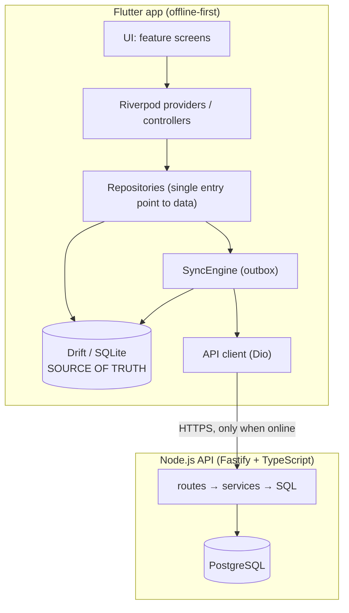

# Astawash · አስታዋሽ

**An offline-first customer-credit ledger for Ethiopian neighborhood shops.**

Replace the paper *dube* notebook with a phone app that works without internet, never loses a birr, and never double-counts an entry.


**Mahlet Getinet** · CTC-1238-26 · INSA 2026 · 5th Batch · Development Department · Room 3004
Instructor: Muhamadawal


---

## Project Information

| | |
|---|---|
| **Student** | Mahlet Getinet |
| **Student ID** | CTC-1238-26 |
| **Program** | INSA 2026 · 5th Batch |
| **Department** | Development |
| **Room** | 3004 |
| **Instructor** | Muhamadawal |
| **Project** | Astawash (አስታዋሽ, "reminder") |

---

## Table of Contents

1. [The Problem](#1-the-problem)
2. [The Solution](#2-the-solution)
3. [Scope](#3-scope)
4. [Core Design Principles](#4-core-design-principles)
5. [Architecture](#5-architecture)
6. [Data Model](#6-data-model)
7. [Sync Protocol](#7-sync-protocol)
8. [Tech Stack](#8-tech-stack)
9. [Repository Layout](#9-repository-layout)
10. [Getting Started](#10-getting-started)
11. [Testing Strategy](#11-testing-strategy)
12. [Roadmap and Current Status](#12-roadmap-and-current-status)
13. [Risks and Mitigations](#13-risks-and-mitigations)
14. [Evaluation Plan](#14-evaluation-plan)
15. [Further Documents](#15-further-documents)

---

## 1. The Problem

Across Ethiopia, neighborhood kiosks and shops sell to regular customers on credit (*dube*). The shopkeeper usually records who owes what in a paper notebook. This fails in predictable ways:

- Notebooks get lost, damaged, or become unreadable.
- Entries are disputed ("I already paid that").
- Totals are added by hand and drift from reality.
- There is no quick way to answer "who owes me the most?"
- Reminding customers is awkward and inconsistent.

Existing apps such as Khatabook and OkCredit target other markets. They are English or Hindi first, assume dependable connectivity, and often bundle payment features that a small kiosk does not need.

## 2. The Solution

Astawash is a mobile app that does one job: **keep a trustworthy record of customer credit**.

- Add a customer, record a credit sale or a repayment in seconds.
- See every customer's balance and a total outstanding figure at a glance.
- Fully usable with **no internet**. Data syncs to a server whenever a connection appears.
- **Amharic-first** interface with English available.
- Prepare a repayment reminder as a pre-filled SMS in one tap. No messaging provider and no cost.

The engineering goal is **financial integrity under unreliable networks**: after any number of offline sessions, dropped connections and retried syncs, every balance is correct and no entry is lost or duplicated.

## 3. Scope

**In scope**

- Customer records (name, phone, note), soft-delete only
- Credit sales, repayments, and corrections through reversals
- Derived per-customer balances and shop-wide total outstanding
- Offline-first local storage
- Phone + PIN authentication
- Push/pull synchronization with an idempotent server
- Amharic and English UI
- Locally generated SMS reminder text

**Explicitly out of scope** (enforced in the project rules file)

Inventory, payment gateways, lending, credit scoring, and accounting. Keeping the product narrow is what makes the integrity guarantees achievable by one developer.

## 4. Core Design Principles

These nine rules are non-negotiable and drive every other decision.

| # | Rule | Why it matters |
|---|---|---|
| 1 | **Money is integer santim.** 25.50 birr is stored as `2550`. No floats anywhere. | Floating point cannot represent decimal money exactly. |
| 2 | **The ledger is append-only.** Entries are never updated or deleted. Mistakes are corrected with a *reversal* entry. | Gives an automatic audit trail and removes write conflicts. |
| 3 | **Balance is derived, never stored.** `balance = SUM(delta_santim)` for the customer. | A stored balance can drift or be overwritten. A sum cannot. |
| 4 | **Delta signs are fixed.** Credit `+amount`, payment `-amount`, reversal `-(original delta)`. An entry can be reversed once; a reversal cannot be reversed. | Keeps the arithmetic unambiguous and the history honest. |
| 5 | **IDs are client-generated UUIDv7** and double as idempotency keys. | The phone can retry a push any number of times and the server stores each entry exactly once. |
| 6 | **Local SQLite is the source of truth.** The UI reads and writes only local data. | The app behaves identically online and offline, and recording a sale is instant. |
| 7 | **Push customers before entries, in one server transaction.** Mark rows synced only after the server confirms. | A crash mid-sync is safe because re-sending is harmless. |
| 8 | **Pull with a server sequence cursor**, never device timestamps. | Avoids clock-skew bugs between devices. |
| 9 | **Customers use last-write-wins on `updated_at`**, with soft delete via `deleted_at`. | Simple, defensible conflict policy for the only mutable records. |

### Why an append-only ledger makes sync tractable

Most sync systems struggle because two devices edit the same row. Here, financial records are *immutable*, so two devices can only ever **add** entries. Added entries never conflict, so there is no merge logic for money. The only mutable rows are customer details, and those use a simple last-write-wins rule.

## 5. Architecture



**Layering rules**

- Widgets contain no business logic and no SQL.
- Network code lives only in `core/sync` and API clients, never in widgets.
- Repositories expose `Stream`s (Drift `watch`) so lists and balances update the UI automatically.
- On the server: route → service → SQL, with no SQL in route handlers and every sync route in a single transaction.

### Authentication

Phone number + PIN. The server stores an **Argon2** hash of the PIN and issues short-lived JWT access tokens plus long-lived refresh tokens. SMS OTP is deliberately avoided: it costs money and requires connectivity. After the first login the app runs fully offline. An expired token while offline only pauses sync; recording continues.

### Reminders

Reminders are generated **on the device**. The app builds a localized message and opens the SMS app pre-filled through an `sms:` URI. It costs nothing and works offline.

## 6. Data Model

The local (SQLite) and server (PostgreSQL) schemas share the same shape.

```
customers
  id            uuid   PK   client-generated
  shop_id       uuid
  name          text   NOT NULL
  phone         text
  note          text
  created_at    timestamp
  updated_at    timestamp         -- last-write-wins key
  deleted_at    timestamp NULL    -- soft delete
  synced_at     timestamp NULL    -- local only: NULL = not yet pushed
  server_seq    bigint NULL       -- assigned by the server

ledger_entries                     -- APPEND-ONLY
  id            uuid   PK   client-generated, idempotency key
  shop_id       uuid
  customer_id   uuid   FK → customers.id
  kind          text   CHECK IN ('credit','payment','reversal')
  amount_santim integer NOT NULL CHECK (amount_santim > 0)
  delta_santim  integer NOT NULL  -- +credit, -payment, reversal = -(original delta)
  reverses_id   uuid NULL  FK → ledger_entries.id   (UNIQUE)
  note          text
  occurred_at   timestamp
  created_at    timestamp
  device_id     text
  synced_at     timestamp NULL    -- local only
  server_seq    bigint NULL

sync_state                         -- local only
  last_pull_seq bigint            -- highest server_seq received
```

The server additionally holds `shops`, `users` (unique phone, PIN hash, shop), and `refresh_tokens`.

**Balance query**

```sql
SELECT COALESCE(SUM(delta_santim), 0)
FROM ledger_entries
WHERE customer_id = ?;
```

**Worked example**

| Entry | Kind | Amount | Delta | Running balance |
|---|---|---|---|---|
| 1 | credit | 150.00 | +15000 | 150.00 |
| 2 | payment | 50.00 | −5000 | 100.00 |
| 3 | credit (entered by mistake) | 20.00 | +2000 | 120.00 |
| 4 | reversal of #3 | 20.00 | −2000 | 100.00 |

Entry 3 is never edited or deleted. Entry 4 cancels it and records *that* a correction happened.

**Database-level protections already implemented**

- `CHECK (amount_santim > 0)` and `CHECK (kind IN (...))`
- Foreign keys on `customer_id` and `reverses_id` (enforced with `PRAGMA foreign_keys = ON`)
- A **unique index on `reverses_id`**, so an entry can be reversed at most once
- A trigger that **aborts any `DELETE`** on `ledger_entries`
- A trigger that **aborts any `UPDATE`** touching financial or audit columns. Only the sync metadata columns `synced_at` and `server_seq` may change.

## 7. Sync Protocol

Sync is a background concern. The UI never waits on it.

### Push: `POST /sync/push` (authenticated)

```json
{ "deviceId": "…", "customers": [ … ], "entries": [ … ] }
```

1. The entire push request runs in **one database transaction**. Concurrent sync writes are serialized so server sequence cursor order follows commit order.
2. Customers are upserted first (last-write-wins on `updated_at`).
3. Entries are inserted with `INSERT … ON CONFLICT (id) DO NOTHING`.
4. The server validates shop ownership from the **JWT, never the request body**, immutable UUID conflicts, customer ownership, money/delta semantics, and reversal rules.
5. Response distinguishes accepted, already-accepted, and rejected customer and ledger IDs.
6. The client sets `synced_at` only for acknowledged IDs. A batch is limited to 200 total changes.

### Pull: `GET /sync/pull?since=<seq>&limit=50`

- Customers and ledger entries are returned in one deterministic sequence-ordered page.
- `nextCursor` is the last included server sequence (or `null` for an empty page); `hasMore` indicates whether another page remains.
- The client applies the full page and cursor in one SQLite transaction, then repeats while `hasMore`.

### Current sync integration

The API client supports registration, login, secure token storage, refresh-token rotation, push, and pull. `SyncEngine.synchronize()` is implemented and callable by the application layer. Automatic scheduling, connectivity-triggered sync, UI status, and app-screen integration are not wired yet.

### Failure rules

| Situation | Behavior |
|---|---|
| Network error | Leave `synced_at` NULL, retry with backoff. |
| `401` / expired refresh token | Stop syncing, clear invalid credentials, and keep pending local changes. |
| Rejected change | Surface its ID and reason; keep it pending for correction or explicit resolution. |
| Network error / app interruption | Keep unacknowledged changes and retry safely using stable UUIDs. |
| Failed pull-page application | Roll back records and cursor together; retry the same page. |

## 8. Tech Stack

**Mobile (Flutter)**

| Concern | Choice |
|---|---|
| State management | `flutter_riverpod` |
| Routing | `go_router` |
| Local database | `drift` (typed SQLite, migrations, reactive streams) |
| HTTP | `dio` |
| Connectivity | `connectivity_plus` |
| Token storage | `flutter_secure_storage` |
| Localization | `flutter_localizations` + `intl` (ARB files: `app_en.arb`, `app_am.arb`) |
| Amharic font | Noto Sans Ethiopic, **bundled** in assets (no runtime download) |
| IDs | `uuid` (v7) |
| Reminders | `url_launcher` (`sms:` URI) |

**Backend (Node.js)**

| Concern | Choice |
|---|---|
| Framework | Fastify, TypeScript (strict) |
| Validation | `zod` |
| Database access | `pg` with plain SQL migrations, **no ORM**, so `ON CONFLICT` and sequences stay explicit |
| Security | `argon2`, `@fastify/jwt`, `@fastify/rate-limit` |
| Tests | `vitest`; PostgreSQL integration tests use `TEST_DATABASE_URL` |
| Local infra | Docker Compose (PostgreSQL 16) |

## 9. Repository Layout

```
Astawashi/
├── mobile/                     Flutter app
│   ├── lib/
│   │   ├── main.dart
│   │   ├── app/                router, theme, app widget
│   │   ├── core/
│   │   │   ├── db/             Drift database, tables, append-only triggers
│   │   │   ├── money/          santim ⇄ birr parsing and formatting
│   │   │   ├── l10n/           ARB files and generated localizations
│   │   │   └── sync/           SyncEngine, secure token store, Dio API client
│   │   └── features/           (planned) auth, customers, ledger, reminders, settings
│   ├── assets/fonts/           Noto Sans Ethiopic
│   └── test/                   unit and widget tests
├── backend/
│   ├── src/                    Fastify server (server.ts, index.ts)
│   └── test/                   vitest tests
├── docker-compose.yml          PostgreSQL 16
├── PLAN.md                     full build plan, architecture reasoning, timeline
├── STARTER_PROMPT.md           prompts used to drive each build session
└── .cursor/rules/              project rules and git workflow
```

Mobile code is **feature-first**: each feature owns `data/`, `domain/` and `presentation/`, and shared code lives in `core/`.

## 10. Getting Started

### Prerequisites

Flutter SDK (Dart ≥ 3.12), Node.js, Docker, and an Android device or emulator.

### Database

```bash
docker compose up -d
# PostgreSQL 16 on localhost:5432
# database: astawash   user: astawash   password: astawash   (local development only)
```

### Backend

```bash
cd backend
npm install
npm run migrate     # apply numbered PostgreSQL migrations
npm test            # runs vitest
npm run build       # compiles TypeScript to dist/
npm start           # serves on http://localhost:3000
curl http://localhost:3000/health     # → {"status":"ok"}
curl http://localhost:3000/ready      # → database readiness
```

#### Deployment configuration

Set these backend environment variables in the deployment environment; do not put production values in source control:

| Variable | Required | Default / purpose |
|---|---:|---|
| `DATABASE_URL` | Yes in production | PostgreSQL connection string. Local development defaults to the Compose database. |
| `JWT_SECRET` | Yes in production | At least 32 characters; production startup fails if missing or too short. |
| `ACCESS_TOKEN_TTL_SECONDS` | No | Positive integer; default `900`. |
| `REFRESH_TOKEN_TTL_SECONDS` | No | Positive integer; default `2592000`. |
| `LOGIN_RATE_LIMIT_MAX` | No | Positive integer; default `5`. |
| `LOGIN_RATE_LIMIT_WINDOW_MS` | No | Positive integer; default `60000`. |

Apply migrations as a release step using `cd backend && npm run migrate` with the target `DATABASE_URL`, after taking a database backup and before routing traffic to a release that depends on the new schema. Test migrations on a disposable database first. The server does not run migrations automatically. `/health` is a process liveness check; `/ready` checks PostgreSQL connectivity.

The mobile `BackendApiClient` receives the backend base URL from its caller; use the environment-specific HTTPS API URL in the app configuration. The API is a native-client API and currently has no browser CORS policy because no web client is shipped. Configure an explicit origin allowlist before introducing browser-based clients.

### Mobile

```bash
cd mobile
flutter pub get
dart run build_runner build --delete-conflicting-outputs   # regenerates Drift code
flutter gen-l10n                                            # regenerates localizations
flutter test
flutter run
```

## 11. Testing Strategy

Correctness of money is the product, so tests come **before** UI.

**Implemented**

- `mobile/test/core/money/santim_test.dart`: parsing, formatting, rejection of invalid or unrepresentable input, 64-bit boundaries
- `mobile/test/core/db/app_database_test.dart`: schema lifecycle, CHECK constraints, foreign keys, and the append-only triggers (DELETE and financial UPDATE blocked; sync metadata updates allowed)
- `backend/test/health.test.ts`: health endpoint
- `backend/test/sync.test.ts` and `backend/test/sync.routes.test.ts`: sync validation, authentication, cursor behavior, and rollback tests
- `backend/test/sync.postgres.test.ts`: live PostgreSQL integration tests when `TEST_DATABASE_URL` points at a disposable migrated test database
- `mobile/test/core/sync/sync_engine_test.dart`: offline push, acknowledgement, retry, auth failure, transactional pull, and cursor behavior

**Required before the matching features ship**

| Area | Cases |
|---|---|
| Ledger | credit · partial payment · full payment · reversal · double-reversal blocked · reversal-of-reversal blocked · balance equals sum of deltas · amount must be > 0 |
| Backend sync | duplicate push is idempotent · partial batch · cross-shop rejection · pull pagination |
| Regression | every bug fixed in money or sync code ships with a test that reproduces it |

## 12. Roadmap and Current Status

Status is based on what exists in the repository.

| Session | Scope | Status |
|---|---|---|
| **0 · Setup** | Monorepo, Postgres Compose, Flutter and backend scaffolds, bundled Ethiopic font | ✅ Done |
| **1 · Core ledger (local only)** | Drift schema, integer money helpers, local customer/ledger repository, balance and append-only tests | ✅ Implemented; UI screens remain planned |
| **2 · Backend + auth** | PostgreSQL migrations, register/login/refresh, rate limit, access-token validation | ✅ Implemented; live PostgreSQL migration path verified locally |
| **3 · Sync** | Authenticated backend push/pull, PostgreSQL integrity, mobile API/token client, Drift SyncEngine | 🟡 Implemented and partially verified; app lifecycle/UI wiring and deployed-service end-to-end test remain |
| **4 · Bilingual + reminders** | Full en/am coverage, language switch, reminder list, SMS template | ⬜ Planned |
| **5 · Hardening + evaluation** | Empty/error states, optional app lock, usability test, final docs | ⬜ Planned |

**Cut line if time runs short** (dropped from the bottom first): background auto-sync → pull sync → reminder polish → runtime language toggle.
**Never cut:** local ledger, push sync, idempotency, balance tests.

## 13. Risks and Mitigations

| Risk | Mitigation |
|---|---|
| Sync scope creep | Push first, pull second. The immutable ledger needs no merge logic. |
| Amharic rendering or input bugs | Font is bundled. Test on a real low-end Android early. |
| Running out of time | Follow the cut line. A finished Session 1 is already a presentable offline product. |
| AI-assisted code drifting from the architecture | Always-on rules file, one step at a time, manual review of every DB and money change. |
| No real users for evaluation | Line up 3 to 5 shopkeepers (family, neighbors) before Session 5. |

## 14. Evaluation Plan

The project will be judged on measurable results, not appearance.

1. **Correctness:** balance and idempotency tests all green.
2. **Offline demo:** record entries in airplane mode, reconnect, and verify them on the server. Kill the app mid-sync, rerun, and confirm there are no duplicates.
3. **Usability:** test with 3 to 5 real shopkeepers and record the time to log a credit sale, register a repayment, and find who owes the most. The target is under 10 seconds to record a sale.

Results will be added here once collected.

## 15. Further Documents

- [`PLAN.md`](PLAN.md): complete build plan, decision rationale, and session timeline
- [`STARTER_PROMPT.md`](STARTER_PROMPT.md): the step-by-step prompts for each session
- [`.cursor/rules/astawash.mdc`](.cursor/rules/astawash.mdc): domain and coding rules
- [`.cursor/rules/git-workflow.mdc`](.cursor/rules/git-workflow.mdc): branch and PR workflow

---


