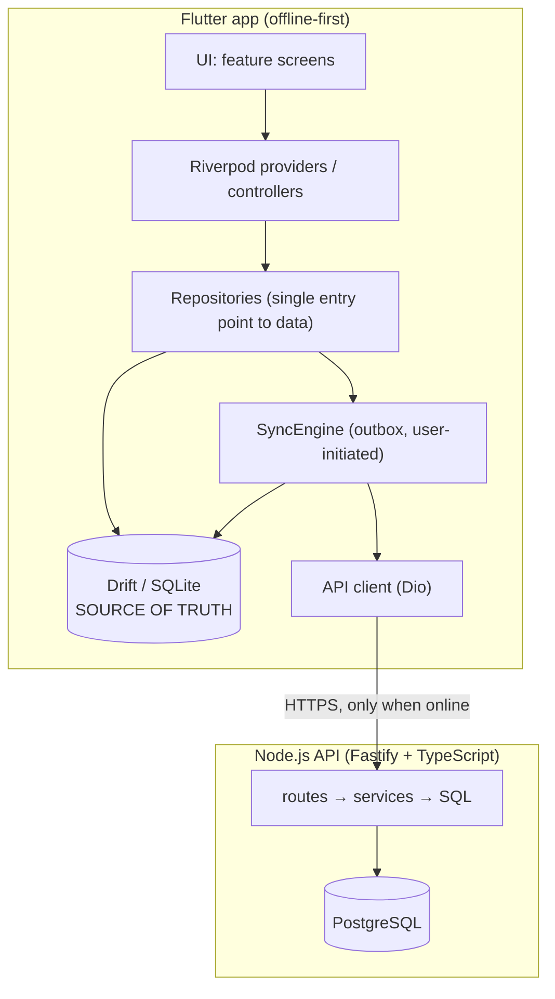

# Astawash · አስታዋሽ

**An offline-first customer-credit ledger for Ethiopian neighborhood shops.**

Replace the paper *dube* notebook with a phone app that works without internet and is designed to preserve accurate, traceable records.


**Individual project** by **Mahlet Getinet** · CTC-1238-26 · INSA 2026 · 5th Batch · Development Department · Room 3004
Instructor: Muhamadawal

---

## Submission Links

| | |
|---|---|
| **GitHub repository** | https://github.com/Faded-MG/Astawashi |
| **5-minute demonstration video** | https://drive.google.com/file/d/1IA2sl4bcjKwlasqK3rsG2JsA6Mv3y5wK/view?usp=drive_link |

---

## Project Information

Astawash (አስታዋሽ, "reminder") is an Amharic-first, offline-first mobile app that replaces the paper *dube* notebook used by Ethiopian neighborhood shops. It records customer credit sales, repayments, balances, and repayment reminders. It is not a payment gateway, lending platform, inventory system, or accounting application.

**Purpose:** give a shopkeeper a trustworthy, dispute-resistant record of who owes what, one that keeps working without internet and stays correct after retried or interrupted synchronization.

**Main features**

- Customer records and a credit-sale / repayment / reversal ledger, with per-customer balances and a shop-wide total outstanding
- Offline-first local storage (Drift / SQLite) as the source of truth
- Append-only ledger enforced by database triggers; mistakes are corrected with reversal entries
- Phone + PIN authentication with refresh-token rotation
- Push and pull synchronization with an idempotent PostgreSQL backend
- Amharic and English interface
- Pre-filled SMS reminder for a customer

### Developer Information

This is an **individual project**; there is no team.

| | |
|---|---|
| **Name** | Mahlet Getinet |
| **CTC ID** | CTC-1238-26 |
| **Program** | INSA 2026 · 5th Batch |
| **Department** | Development |
| **Room** | 3004 |
| **Instructor** | Muhamadawal |

---

## Table of Contents

1. [The Problem](#1-the-problem)
2. [The Solution](#2-the-solution)
3. [Scope](#3-scope)
4. [Core Design Principles](#4-core-design-principles)
5. [Architecture](#5-architecture)
6. [Data Model](#6-data-model)
7. [Sync Protocol](#7-sync-protocol)
8. [Tech Stack](#8-tech-stack)
9. [Repository Layout](#9-repository-layout)
10. [Getting Started](#10-getting-started)
11. [Testing Strategy](#11-testing-strategy)
12. [Implementation Status](#12-implementation-status)
13. [Risks and Mitigations](#13-risks-and-mitigations)
14. [Evaluation](#14-evaluation)

---

## 1. The Problem

Across Ethiopia, neighborhood kiosks and shops sell to regular customers on credit (*dube*). The shopkeeper usually records who owes what in a paper notebook. This fails in predictable ways:

- Notebooks get lost, damaged, or become unreadable.
- Entries are disputed ("I already paid that").
- Totals are added by hand and drift from reality.
- There is no quick way to answer "who owes me the most?"
- Reminding customers is awkward and inconsistent.

Existing apps such as Khatabook and OkCredit target other markets. They are English or Hindi first, assume dependable connectivity, and often bundle payment features that a small kiosk does not need.

## 2. The Solution

Astawash is a mobile app that does one job: **keep a trustworthy record of customer credit**.

- Add a customer, record a credit sale or a repayment in seconds.
- See every customer's balance and a total outstanding figure at a glance.
- Fully usable with **no internet**. Data is synchronized with the server when the user starts a sync from the More screen.
- **Amharic-first** interface with English available.
- Prepare a repayment reminder as a pre-filled SMS in one tap. No messaging provider is required; standard carrier SMS charges may apply.

The engineering goal is **financial integrity under unreliable networks**: after any number of offline sessions, dropped connections and retried syncs, every balance is correct and no entry is lost or duplicated.

## 3. Scope

**In scope**

- Customer records (name, phone, note), soft-delete only
- Credit sales, repayments, and corrections through reversals
- Derived per-customer balances and shop-wide total outstanding
- Offline-first local storage
- Phone + PIN authentication
- Push/pull synchronization with an idempotent server
- Amharic and English UI
- Locally generated SMS reminder text

**Explicitly out of scope**

Inventory, payment gateways, lending, credit scoring, and accounting. Keeping the product narrow is what makes the integrity guarantees achievable by one developer.

## 4. Core Design Principles

These nine rules are non-negotiable and drive every other decision.

| # | Rule | Why it matters |
|---|---|---|
| 1 | **Money is integer santim.** 25.50 birr is stored as `2550`. No floats anywhere. | Floating point cannot represent decimal money exactly. |
| 2 | **The ledger is append-only.** Entries are never updated or deleted. Mistakes are corrected with a *reversal* entry. | Gives an automatic audit trail and removes write conflicts. |
| 3 | **Balance is derived, never stored.** `balance = SUM(delta_santim)` for the customer. | A stored balance can drift or be overwritten. A sum cannot. |
| 4 | **Delta signs are fixed.** Credit `+amount`, payment `-amount`, reversal `-(original delta)`. An entry can be reversed once; a reversal cannot be reversed. | Keeps the arithmetic unambiguous and the history honest. |
| 5 | **IDs are client-generated UUIDv7** and double as idempotency keys. | The phone can retry a push any number of times and the server stores each entry exactly once. |
| 6 | **Local SQLite is the source of truth.** The UI reads and writes only local data. | The app behaves identically online and offline, and recording a sale is instant. |
| 7 | **Push customers before entries, in one server transaction.** Mark rows synced only after the server confirms. | A crash mid-sync is safe because re-sending is harmless. |
| 8 | **Pull with a server sequence cursor**, never device timestamps. | Avoids clock-skew bugs between devices. |
| 9 | **Customers use last-write-wins on `updated_at`**, with soft delete via `deleted_at`. | Simple, defensible conflict policy for the only mutable records. |

### Why an append-only ledger makes sync tractable

Most sync systems struggle because two devices edit the same row. Here, financial records are *immutable*, so two devices can only ever **add** entries. Added entries never conflict, so there is no merge logic for money. The only mutable rows are customer details, and those use a simple last-write-wins rule.

## 5. Architecture



**Layering rules**

- Widgets contain no business logic and no SQL.
- Network code lives only in `core/sync` and API clients, never in widgets.
- Repositories expose `Stream`s (Drift `watch`) so lists and balances update the UI automatically.
- On the server: route → service → SQL, with no SQL in route handlers and every sync route in a single transaction.

### Authentication

Phone number + PIN. The server stores an **Argon2** hash of the PIN and issues short-lived JWT access tokens plus long-lived refresh tokens. SMS OTP is deliberately avoided: it costs money and requires connectivity. After the first login the app runs fully offline. An expired token while offline only pauses sync; recording continues.

### Reminders

Reminders are generated **on the device**. The app builds a localized message and opens the SMS app pre-filled through an `sms:` URI. The reminder is prepared on-device; standard carrier SMS charges may apply when sent.

## 6. Data Model

The local (SQLite) and server (PostgreSQL) schemas share the same shape.

```
customers
  id            uuid   PK   client-generated
  shop_id       uuid
  name          text   NOT NULL
  phone         text
  note          text
  created_at    timestamp
  updated_at    timestamp         -- last-write-wins key
  deleted_at    timestamp NULL    -- soft delete
  synced_at     timestamp NULL    -- local only: NULL = not yet pushed
  server_seq    bigint NULL       -- assigned by the server

ledger_entries                     -- APPEND-ONLY
  id            uuid   PK   client-generated, idempotency key
  shop_id       uuid
  customer_id   uuid   FK → customers.id
  kind          text   CHECK IN ('credit','payment','reversal')
  amount_santim integer NOT NULL CHECK (amount_santim > 0)
  delta_santim  integer NOT NULL  -- +credit, -payment, reversal = -(original delta)
  reverses_id   uuid NULL  FK → ledger_entries.id   (UNIQUE)
  note          text
  occurred_at   timestamp
  created_at    timestamp
  device_id     text
  synced_at     timestamp NULL    -- local only
  server_seq    bigint NULL

sync_state                         -- local only
  last_pull_seq bigint            -- highest server_seq received
```

The server additionally holds `shops`, `users` (unique phone, PIN hash, shop), and `refresh_tokens`.

**Balance query**

```sql
SELECT COALESCE(SUM(delta_santim), 0)
FROM ledger_entries
WHERE customer_id = ?;
```

**Worked example**

| Entry | Kind | Amount | Delta | Running balance |
|---|---|---|---|---|
| 1 | credit | 150.00 | +15000 | 150.00 |
| 2 | payment | 50.00 | −5000 | 100.00 |
| 3 | credit (entered by mistake) | 20.00 | +2000 | 120.00 |
| 4 | reversal of #3 | 20.00 | −2000 | 100.00 |

Entry 3 is never edited or deleted. Entry 4 cancels it and records *that* a correction happened.

**Database-level protections already implemented**

- `CHECK (amount_santim > 0)` and `CHECK (kind IN (...))`
- Foreign keys on `customer_id` and `reverses_id` (enforced with `PRAGMA foreign_keys = ON`)
- A **unique index on `reverses_id`**, so an entry can be reversed at most once
- A trigger that **aborts any `DELETE`** on `ledger_entries`
- A trigger that **aborts any `UPDATE`** touching financial or audit columns. Only the sync metadata columns `synced_at` and `server_seq` may change.

## 7. Sync Protocol

Sync is user-initiated through the **Synchronize now** action on the More screen. It is separate from recording: entries are always saved locally first, and recording never waits on the network.

### Push: `POST /sync/push` (authenticated)

```json
{ "deviceId": "…", "customers": [ … ], "entries": [ … ] }
```

1. The entire push request runs in **one database transaction**. Concurrent sync writes are serialized so server sequence cursor order follows commit order.
2. Customers are upserted first (last-write-wins on `updated_at`).
3. Entries are inserted with `INSERT … ON CONFLICT (id) DO NOTHING`.
4. The server validates shop ownership from the **JWT, never the request body**, immutable UUID conflicts, customer ownership, money/delta semantics, and reversal rules.
5. Response distinguishes accepted, already-accepted, and rejected customer and ledger IDs.
6. The client sets `synced_at` only for acknowledged IDs. A batch is limited to 200 total changes.

### Pull: `GET /sync/pull?since=<seq>&limit=50`

- Customers and ledger entries are returned in one deterministic sequence-ordered page.
- `nextCursor` is the last included server sequence (or `null` for an empty page); `hasMore` indicates whether another page remains.
- The client applies the full page and cursor in one SQLite transaction, then repeats while `hasMore`.

### Current sync integration

The API client supports registration, login, secure token storage, refresh-token rotation, push, and pull. `SyncEngine.synchronize()` (push, then pull) is wired to the app through `AppSyncController` and triggered by the **Synchronize now** action on the More screen, which shows the live status (idle, syncing, success, failure), the last result, and any error. Synchronization is manual only: automatic/background synchronization, connectivity-triggered synchronization, and automatic retry with backoff are **not implemented** (see [Implementation Status](#12-implementation-status)).

### Failure rules

| Situation | Behavior |
|---|---|
| Network error / app interruption | Keep unacknowledged changes pending; retry safely on the next manual sync using stable UUIDs. |
| `401` / expired refresh token | Stop syncing, clear invalid credentials, and keep pending local changes. |
| Rejected change | Surface its ID and reason; keep it pending for correction or explicit resolution. |
| Failed pull-page application | Roll back records and cursor together; the same page is retried on the next manual sync. |

## 8. Tech Stack

**Mobile (Flutter)**

| Concern | Choice |
|---|---|
| State management | `flutter_riverpod` |
| Routing | `go_router` |
| Local database | `drift` (typed SQLite, migrations, reactive streams) |
| HTTP | `dio` |
| Connectivity | `connectivity_plus` (declared dependency; not yet used to trigger sync) |
| Token storage | `flutter_secure_storage` |
| Localization | `flutter_localizations` + `intl` (ARB files: `app_en.arb`, `app_am.arb`) |
| Amharic font | Noto Sans Ethiopic, **bundled** in assets (no runtime download) |
| IDs | `uuid` (v7) |
| Reminders | `url_launcher` (`sms:` URI) |

**Backend (Node.js)**

| Concern | Choice |
|---|---|
| Framework | Fastify, TypeScript (strict) |
| Validation | `zod` |
| Database access | `pg` with plain SQL migrations, **no ORM**, so `ON CONFLICT` and sequences stay explicit |
| Security | `argon2` (PIN hashing), `@fastify/jwt` (access/refresh tokens), `@fastify/rate-limit` (per-route limits on auth endpoints). All three are installed and in use. |
| Tests | `vitest`; PostgreSQL integration tests use `TEST_DATABASE_URL` |
| Local infra | Docker Compose (PostgreSQL 16) |

## 9. Repository Layout

```
Astawashi/
├── mobile/                     Flutter app
│   ├── lib/
│   │   ├── main.dart
│   │   ├── app/                providers, router, theme, shared widgets
│   │   ├── core/
│   │   │   ├── db/             Drift database, tables, append-only triggers
│   │   │   ├── money/          santim ⇄ birr parsing and formatting
│   │   │   ├── l10n/           ARB files and generated localizations
│   │   │   └── sync/           SyncEngine, AppSyncController, sync API client,
│   │   │                       sync models, secure token store
│   │   └── features/
│   │       ├── auth/           onboarding, sign-in, splash screens
│   │       ├── customers/      customer list, add customer, customer detail
│   │       │                   (balance, history, reversal, SMS reminder)
│   │       ├── dashboard/      home dashboard, total outstanding
│   │       ├── ledger/         local ledger repository, ledger screen,
│   │       │                   credit-sale and repayment sheets
│   │       └── settings/       language, manual sync, sign-out
│   ├── assets/fonts/           Noto Sans Ethiopic
│   └── test/                   unit and widget tests
├── backend/
│   ├── src/
│   │   ├── server.ts, index.ts, config.ts
│   │   ├── db/                 connection pool, numbered migrations (001–003)
│   │   └── modules/
│   │       ├── auth/           register, login, refresh, Argon2 PIN hashing
│   │       └── sync/           push and pull service and repository
│   ├── scripts/migrate.js      migration runner
│   └── test/                   vitest tests
└── docker-compose.yml          PostgreSQL 16
```

Mobile code is **feature-first**: each feature owns its screens under `presentation/` (the ledger feature also owns its local `data/` repository), and shared code lives in `core/` and `app/`.

## 10. Getting Started

### Prerequisites

Flutter SDK (Dart ≥ 3.12), Node.js, Docker, and an Android device or emulator.

### Database

```bash
docker compose up -d
# PostgreSQL 16 on localhost:5432
# database: astawash   user: astawash   password: astawash   (local development only)
```

### Backend

```bash
cd backend
npm install
npm run migrate     # apply numbered PostgreSQL migrations
npm test            # runs vitest
npm run build       # compiles TypeScript to dist/
npm start           # serves on http://localhost:3000
curl http://localhost:3000/health     # → {"status":"ok"}
curl http://localhost:3000/ready      # → database readiness
```

#### Deployment configuration

Set these backend environment variables in the deployment environment; do not put production values in source control:

| Variable | Required | Default / purpose |
|---|---:|---|
| `DATABASE_URL` | Yes in production | PostgreSQL connection string. Local development defaults to the Compose database. |
| `JWT_SECRET` | Yes in production | At least 32 characters; production startup fails if missing or too short. |
| `ACCESS_TOKEN_TTL_SECONDS` | No | Positive integer; default `900`. |
| `REFRESH_TOKEN_TTL_SECONDS` | No | Positive integer; default `2592000`. |
| `LOGIN_RATE_LIMIT_MAX` | No | Positive integer; default `5`. |
| `LOGIN_RATE_LIMIT_WINDOW_MS` | No | Positive integer; default `60000`. |

Apply migrations as a release step using `cd backend && npm run migrate` with the target `DATABASE_URL`, after taking a database backup and before routing traffic to a release that depends on the new schema. Test migrations on a disposable database first. The server does not run migrations automatically. `/health` is a process liveness check; `/ready` checks PostgreSQL connectivity.

The Flutter app reads its backend URL from `ASTAWASH_API_BASE_URL` at build/run time; source edits are not needed to change environments. Its default is `http://localhost:3000` for desktop/iOS simulator development. For an Android emulator, use `http://10.0.2.2:3000`. Production builds must use the deployed HTTPS URL. The API is a native-client API and currently has no browser CORS policy because no web client is shipped. Configure an explicit origin allowlist before introducing browser-based clients.

### Mobile

```bash
cd mobile
flutter pub get
dart run build_runner build --delete-conflicting-outputs   # regenerates Drift code
flutter gen-l10n                                            # regenerates localizations
flutter test
flutter run --dart-define=ASTAWASH_API_BASE_URL=http://10.0.2.2:3000
```

For an iOS simulator or desktop run against a local backend, use
`--dart-define=ASTAWASH_API_BASE_URL=http://localhost:3000`. For production,
replace the value with the deployed HTTPS API URL. The app restores credentials
from secure storage, allows registration/login, and exposes a manual
**Synchronize now** action. Sync failure and expired authentication are shown
in the app; local Drift data remains available and pending rows are not cleared
without server acknowledgement. Customer and ledger-entry screens (add customer,
record credit sale, record repayment, reverse entry) are part of the app.
Synchronization is started manually from the More screen; automatic/background
synchronization, connectivity-triggered synchronization, and automatic retry
with backoff are not implemented.

### Deployment and demonstration checklist

1. Provision a **staging** PostgreSQL database first. Keep its TLS connection
   string private and take a backup before schema changes.
2. Configure the backend service's `DATABASE_URL` and a new `JWT_SECRET`
   (generate one with `openssl rand -base64 48` and store it only in the
   deployment provider's secret manager). Configure optional token/rate-limit
   values only if needed. Never commit or paste real values into source.
3. For a release, install dependencies and build, then run migrations once as a
   release step before starting the new service:

   ```bash
   cd backend
   npm ci
   npm run build
   npm run migrate
   npm start
   ```

   On a managed platform, use `npm run migrate` as the release/pre-deploy
   command and `npm start` as the service command. Set its readiness probe to
   `/ready` and verify both endpoints:

   ```bash
   curl --fail https://YOUR-STAGING-API/health
   curl --fail https://YOUR-STAGING-API/ready
   ```

4. Point a development build at staging without editing source:

   ```bash
   cd mobile
   flutter run --dart-define=ASTAWASH_API_BASE_URL=https://YOUR-STAGING-API
   ```

   Create a test shop account in the app, sign in, and tap **Synchronize now**.
   For automated data-bearing verification (local Drift -> deployed API ->
   PostgreSQL -> a second local Drift database), use a disposable staging
   database/service only:

   ```bash
   cd mobile
   ASTAWASH_TEST_API_BASE_URL=https://YOUR-STAGING-API \
     flutter test test/core/sync/live_sync_e2e_test.dart
   ```

   This test creates temporary test shops and ledger data on the configured
   service. Do not point it at production. It tests a simulated network refusal,
   retry/idempotency, pull application, balances, and shop isolation. The test
   creates its records offline through the real local ledger repository.

## 11. Testing Strategy

Correctness of money is the product, so tests come **before** UI.

**Implemented**

- `mobile/test/core/money/santim_test.dart`: parsing, formatting, rejection of invalid or unrepresentable input, 64-bit boundaries
- `mobile/test/core/db/app_database_test.dart`: schema lifecycle, CHECK constraints, foreign keys, and the append-only triggers (DELETE and financial UPDATE blocked; sync metadata updates allowed)
- `backend/test/health.test.ts`, `auth.test.ts`, `config.test.ts`, `migrations.test.ts`: health endpoints, authentication, configuration safety, and migrations
- `mobile/test/features/ledger/data/local_ledger_repository_test.dart`, `mobile/test/core/sync/backend_api_client_test.dart`, and `mobile/test/features/ui_reference_test.dart`: local ledger repository, API client, and UI reference checks
- `backend/test/sync.test.ts` and `backend/test/sync.routes.test.ts`: sync validation, authentication, cursor behavior, and rollback tests
- `backend/test/sync.postgres.test.ts`: live PostgreSQL integration tests when `TEST_DATABASE_URL` points at a disposable migrated test database
- `mobile/test/core/sync/sync_engine_test.dart`: offline push, acknowledgement, retry, auth failure, transactional pull, and cursor behavior
- `mobile/test/core/sync/app_sync_controller_test.dart` and `mobile/test/widget_test.dart`: app-level authentication, visible sync failures, and manual sync trigger
- `mobile/test/core/sync/live_sync_e2e_test.dart`: actual API/PostgreSQL and two-local-database path when `ASTAWASH_TEST_API_BASE_URL` points at a disposable test/staging service

**Recorded results**

Latest local test run:

| Suite | Passed | Skipped | Failed | Notes |
|---|---:|---:|---:|---|
| Backend (Vitest, `cd backend && npm test`) | 27 | 5 | 0 | 6 test files passed, 1 skipped |
| Mobile (Flutter, `cd mobile && flutter test`) | 87 | 1 | 0 | |
| **Combined** | **114** | **6** | **0** | |

The five skipped backend tests are the PostgreSQL integration tests in `sync.postgres.test.ts`. They were skipped because the integration-test database configuration (`TEST_DATABASE_URL`) was unavailable during this run, so they have **not** been run and are not counted as passed.

**Coverage targets**

| Area | Cases |
|---|---|
| Ledger | credit · partial payment · full payment · reversal · double-reversal blocked · reversal-of-reversal blocked · balance equals sum of deltas · amount must be > 0 |
| Backend sync | duplicate push is idempotent · partial batch · cross-shop rejection · pull pagination |
| Regression | every bug fixed in money or sync code ships with a test that reproduces it |


## 12. Implementation Status

Status below reflects what is present in the source code of this repository's `main` branch.

| Area | Status | Notes |
|---|---|---|
| Money as integer santim | Implemented | `core/money`, unit-tested |
| Local Drift/SQLite database, source of truth | Implemented | `core/db` |
| Append-only ledger protections | Implemented | Local and PostgreSQL triggers; `CHECK` constraints; unique `reverses_id` |
| Customer screens | Implemented | List, add customer, detail with balance and history |
| Ledger-entry screens | Implemented | Credit sale and repayment sheets; reverse entry |
| Feature-first folder structure | Implemented | `mobile/lib/features/*` |
| Phone + PIN authentication | Implemented | Argon2 hash, JWT access tokens, rate-limited auth routes |
| Token refresh | Implemented | Server `/auth/refresh`; client retries once after `401` |
| SMS reminder | Implemented (on-device) | Pre-filled `sms:` message, localized; no messaging provider |
| Amharic and English UI | Implemented | ARB files, bundled Ethiopic font |
| Push synchronization | Implemented | Single transaction, 200-change batches |
| Pull synchronization | Implemented | Sequence cursor, paged, applied atomically |
| Safe duplicate sync requests | Implemented | `ON CONFLICT (id) DO NOTHING`; acknowledged vs already-accepted IDs |
| Failure handling | Implemented | Unacknowledged rows stay pending; rejected changes reported; auth failure stops sync |
| Manual synchronization with visible status | Implemented | More screen: idle / syncing / success / failure and error message |
| Automatic/background synchronization | Not implemented (future) | No scheduler or periodic trigger; sync is started manually |
| Connectivity-triggered synchronization | Not implemented (future) | `connectivity_plus` is declared but not used |
| Automatic retry with backoff | Not implemented (future) | Failed or unacknowledged changes stay pending and are retried on the next manual sync |

**Future improvements:** automatic and connectivity-triggered synchronization with backoff, a persistent sync indicator on the dashboard, and a server-side SMS channel (not required for the core product).

## 13. Risks and Mitigations

| Risk | Mitigation |
|---|---|
| Sync scope creep | Push first, pull second. The immutable ledger needs no merge logic. |
| Amharic rendering or input bugs | Font is bundled. Test on a real low-end Android early. |
| Running out of time | Scope is kept narrow (see [Scope](#3-scope)); no inventory, payments, lending, or accounting features. |
| AI-assisted code drifting from the architecture | Architecture rules are documented in this README; one step at a time, with manual review of every DB and money change. |
| No real users for evaluation | Mitigated: the app was tested by 3 to 5 shopkeepers. Detailed findings are not yet documented (see [Evaluation](#14-evaluation)). |

## 14. Evaluation

The project is judged on measurable results, not appearance. Technical testing and user evaluation are kept separate.

**Technical testing**

1. **Correctness:** automated tests cover money, ledger integrity, sync, and authentication. Recorded results are in [Testing Strategy](#11-testing-strategy).
2. **Offline demo:** record entries in airplane mode, reconnect, run **Synchronize now**, and verify them on the server. Kill the app mid-sync, rerun, and confirm there are no duplicates.

**User evaluation**

Usability testing was conducted with 3 to 5 shopkeepers. The planned tasks were to log a credit sale, register a repayment, and find who owes the most, with a target of under 10 seconds to record a sale.

Detailed findings (task times, observations, feedback) have not yet been documented, so no usability results are claimed here.
